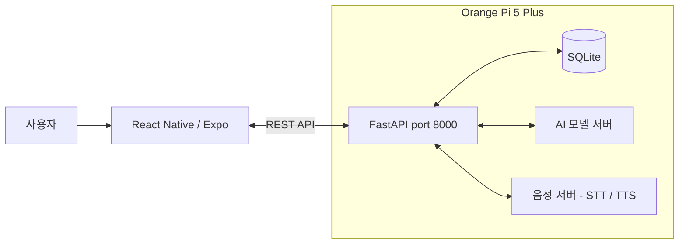

# 너만의 비서 Server

물류창고 작업 비서 **너만의 비서**의 서버 시스템입니다. FastAPI를 기반으로 일정 관리 API, 텍스트 및 음성 AI 처리, Orange Pi 온디바이스 실행 환경을 제공합니다.

모바일 앱은 별도의 [frontend](https://github.com/mobile-agent-6/frontend) 저장소에서 관리합니다.

---

## 기술 스택


| 구분 | 기술 |
| --- | --- |
| 언어 | Python 3.11 |
| 백엔드 API | FastAPI 0.141.1 / Uvicorn 0.54.0 |
| 음성 API | FastAPI 0.162.7 / Uvicorn 0.54.0 |
| 설정 및 데이터 검증 | Pydantic 2.13.5 / Pydantic Settings 2.15.0 |
| 데이터베이스 | SQLite / SQLAlchemy 2.0.54 |
| 마이그레이션 | Alembic 1.20.0 |
| API 명세 | OpenAPI |
| 언어 모델 | Qwen3-4B-4bit / LoRA |
| 모델 학습 및 평가 | MLX |
| NPU 추론 | RKLLM / RKNPU / Flask 3.1.3 |
| 음성 인식 | faster-whisper 1.2.1 / CTranslate2 4.9.0 |
| 음성 합성 | Piper TTS 1.8.0 / ONNX Runtime 1.32.0 |
| 배포 장비 | Orange Pi 5 Plus |
| 운영 환경 | Ubuntu 22.04.5 / systemd |
| 패키지 매니저 | pip |
| 테스트 | pytest 9.1.1 / pytest-cov 7.1.0 |
| CI | GitHub Actions |

---

## 시스템 구조



모바일 앱은 REST API를 통해 백엔드와 통신합니다. 백엔드는 일정 데이터와 대화 상태를 관리하고, Orange Pi 내부의 AI 모델 서버와 음성 서버를 호출합니다. 모델 출력을 검증한 뒤 일정 조회와 변경을 실행합니다.

---

## 프로젝트 구조

```text
server
├── backend/
│   ├── app/
│   │   ├── core/                   # 설정, DB 연결, 공통 예외와 미들웨어
│   │   └── modules/
│   │       ├── schedules/          # 일정 CRUD, 완료 상태와 멱등성 처리
│   │       ├── assistant/          # 멀티턴 처리, 요청 복구와 안전한 일정 변경
│   │       ├── voice/              # Voice API와 음성 서버 연동
│   │       └── system/             # /health와 시간 동기화
│   ├── alembic/                    # SQLite 스키마 마이그레이션
│   ├── scripts/                    # API 계약, 런타임 잠금 파일과 wheelhouse 검증
│   └── tests/                      # API, 단위 및 통합 테스트
├── ai/
│   ├── deploy/                     # Orange Pi 설치, systemd 서비스와 재배포 도구
│   ├── rkllm_runtime/              # RKLLM NPU 모델 서버 환경
│   ├── schedule_assistant/         # Qwen 대화 제어 로컬 시범 구현
│   ├── voice_server/
│   │   └── models/                 # Piper 한국어 모델 설정 파일
│   └── tests/                      # AI, 음성 및 배포 도구 테스트
├── datasets/
│   └── qwen/
│       ├── experiments/
│       │   └── logistics440_v37/   # 실제 학습 440예시와 v37 후처리 및 평가
│       ├── tools/                  # 데이터 생성, 평가 및 검수 도구
│       └── tests/                  # 데이터와 검증 도구 테스트
├── docs/                           # API, 모델 연동, 배포와 설계 문서
├── .github/                        # 백엔드 CI 워크플로
└── TEAM_GUIDELINES.md              # 팀 역할과 저장소 작업 기준
```

---

## 데이터베이스 구조

SQLite는 일정, 중복 요청 방지, Assistant 대화와 요청 상태를 여섯 개 테이블에 저장합니다.

- `schedules`
- `idempotency_records`
- `assistant_conversations`
- `assistant_requests`
- `assistant_questions`
- `assistant_write_gate`

상세 ERD와 테이블 설명은 [`docs/erd.md`](docs/erd.md)를 참고하세요.

---

## 주요 기능

1. **일정 관리 API (Schedule API)**
   - 일정 등록, 조회, 수정과 삭제
   - 완료와 미완료 상태 변경
   - 날짜, 카테고리와 완료 상태별 조회

2. **대화형 일정 비서 (Schedule Assistant)**
   - 자연어 일정 요청 해석
   - 빠진 날짜, 시간과 제목 추가 질문
   - 여러 일정 중 변경 대상을 선택하는 멀티턴 대화
   - 일정 수정과 삭제 전 사용자 확인

3. **음성 인식과 합성 (Voice API)**
   - 모바일 앱에서 녹음한 WAV 파일 수신
   - faster-whisper 기반 한국어 음성 인식
   - 인식 결과를 일정 비서 요청으로 연결
   - Piper 기반 한국어 음성 응답 생성

4. **온디바이스 AI 처리**
   - Qwen3-4B 기반 일정 요청 해석
   - v37 후처리와 구조화 출력 검증
   - RKLLM 기반 Orange Pi NPU 추론
   - 외부 AI 서비스에 의존하지 않는 로컬 처리

5. **안전한 요청과 복구 처리**
   - 멱등성 키를 이용한 중복 일정 등록 방지
   - Assistant 요청, 질문과 처리 상태 저장
   - 통신 단절이나 서버 재시작 후 기존 요청 조회
   - 사용자 승인 전 수정과 삭제 실행 차단

6. **Orange Pi 배포와 운영**
   - 백엔드, NPU 및 음성 서버의 3개 systemd 서비스 구성
   - 고정된 의존성을 이용한 실행 환경 설치
   - 재부팅 후 서비스 자동 시작과 `/health` 확인
   - 백업, 마이그레이션과 서비스 재시작을 포함한 재배포 도구 제공

---

## Getting Started

### 사전 요구사항

- Git
- Python 3.11

모델 추론, 음성 처리와 Orange Pi 배포에는 별도의 모델 파일과 실행 환경이 필요합니다. 구성 요소별 준비 사항은 하단의 상세 문서를 참고합니다.

### 백엔드 로컬 실행

```bash
git clone https://github.com/mobile-agent-6/server.git
cd server
git switch develop

cd backend
python3.11 -m venv .venv
source .venv/bin/activate
python -m pip install -r requirements.lock

cp .env.example .env
mkdir -p data
python -m alembic upgrade head

python -m uvicorn app.main:app --host 0.0.0.0 --port 8000
```

모델 서버와 음성 서버를 실행하지 않아도 일정 관리 API와 상태 확인 기능을 사용할 수 있습니다.

- 상태 확인: <http://127.0.0.1:8000/health>

### 구성요소별 안내

| 구성요소 | 상세 문서 |
| --- | --- |
| 백엔드 API 실행과 설정 | [`backend/README.md`](backend/README.md) |
| AI 일정 비서와 로컬 시범 실행 | [`ai/README.md`](ai/README.md) |
| 학습 데이터와 평가 도구 | [`datasets/README.md`](datasets/README.md) |
| Orange Pi 설치와 재배포 | [`ai/deploy/README.md`](ai/deploy/README.md) |

### 테스트

**백엔드 전체 테스트**

```bash
cd backend
python -m pytest --cov=app --cov-branch --cov-report=term-missing
```

**AI, 음성 및 배포 도구 테스트**

```bash
python -m unittest discover -s ai/tests -v
```

**데이터 생성 및 검증 도구 테스트**

```bash
python -m unittest discover -s datasets/qwen/tests
```

---

## API 문서

백엔드 실행 후 다음 주소와 문서에서 API를 확인할 수 있습니다.

- Swagger UI: <http://127.0.0.1:8000/docs>
- 상세 API 명세: [`docs/api.md`](docs/api.md)
- OpenAPI 원본: [`docs/openapi.json`](docs/openapi.json)

---

## 테스트 및 검증 결과

| 검증 항목 | 결과 |
| --- | --- |
| 백엔드 전체 자동화 테스트 | 1,515건 통과, 1건 건너뜀 |
| v37 개발 자료 재평가 | 멀티턴 고유 모델 입력 132건 중 132건 일치 |
| Orange Pi 실제 음성 시나리오 반복 검증 | 핵심 시나리오 3개를 각 10회, 총 30회 통과 |
| Orange Pi 배포와 재부팅 검증 | 재부팅 후 백엔드, NPU 및 음성 서버 자동 시작과 `/health` 200 응답 확인 |
| iOS / Orange Pi 음성 통합 검증 | 8/8 통과 |

---

## CI

| Job | 트리거 | 검증 내용 |
| --- | --- | --- |
| Backend CI | PR → `develop` / push → `develop`, `main` / 수동 실행 | Python 3.11 의존성 설치, `pip check`, 전체 pytest, 브랜치 커버리지, Python 패키지 빌드 |

CI는 Python 3.11 환경에서 실행됩니다. 자세한 내용은 [CI 워크플로](.github/workflows/backend-ci.yml)를 참고하세요.

---

## 브랜치 전략

| 브랜치 | 용도 |
| --- | --- |
| `main` | 최종 시연 및 배포용 안정 브랜치 |
| `develop` | 기본 개발 통합 브랜치 |
| `feature/<이름>` | 기능 개발과 개선 |
| `fix/<이름>` | 버그 수정 |
| `docs/<이름>` | 문서 작업 |
| `test/<이름>` | 테스트 추가와 검증 |
| `chore/<이름>` | 의존성, 설정과 관리 작업 |
| `hotfix/<이름>` | 안정 브랜치의 긴급 수정 |

Issue, 커밋, Pull Request 및 병합 규칙은 [TEAM_GUIDELINES.md](TEAM_GUIDELINES.md)를 참고하세요.

---

## 팀

<table>
  <tr>
    <td align="center" width="180">
      <a href="https://github.com/nYeonG4001">
        
      </a>
      <br />
      <strong>박하영</strong>
      <br />
      <sub>Backend API, Database, Schedule Assistant API &amp; Workflow</sub>
      <br />
      <a href="https://github.com/nYeonG4001">@nYeonG4001</a>
    </td>
    <td align="center" width="180">
      <a href="https://github.com/Park-Youngho">
        
      </a>
      <br />
      <strong>박영호</strong>
      <br />
      <sub>Dataset Engineering, STT/TTS, Orange Pi Deployment</sub>
      <br />
      <a href="https://github.com/Park-Youngho">@Park-Youngho</a>
    </td>
    <td align="center" width="180">
      <a href="https://github.com/colin718">
        
      </a>
      <br />
      <strong>유재훈</strong>
      <br />
      <sub>AI Model Training, Training Data, Model Evaluation, RKLLM Conversion</sub>
      <br />
      <a href="https://github.com/colin718">@colin718</a>
    </td>
  </tr>
</table>
