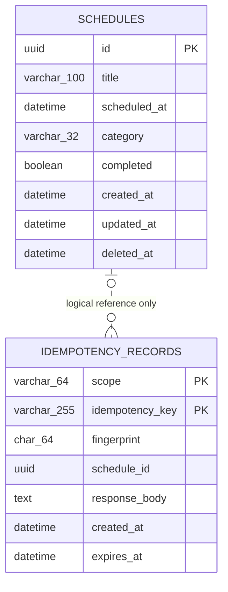
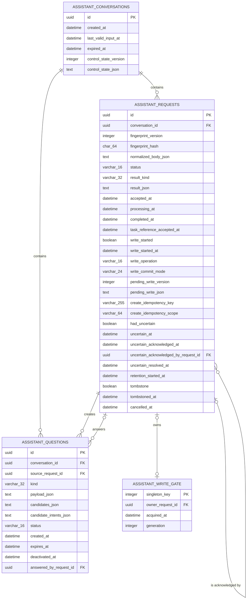

# Schedule 및 Assistant 데이터베이스 ERD

> 상태: `BE-CONFIRMED`
> 범위: MVP Schedule 및 Assistant 영속 데이터
> 기준 Alembic revision: `20261017_0004`

## 1. 개요

MVP 데이터베이스는 다음 여섯 테이블로 구성한다.

- `schedules`: 일정의 현재 상태와 soft delete 상태 저장
- `idempotency_records`: 일정 생성 성공 응답을 24시간 동안 재생하기 위한 멱등성 기록 저장
- `assistant_conversations`: Assistant 대화 수명과 제어 상태 저장
- `assistant_requests`: Assistant 요청의 입력, 처리 상태, 공개 결과와 안전 실행 이력 저장
- `assistant_questions`: 추가 질문, 후보 선택과 승인 상태 저장
- `assistant_write_gate`: 동시에 하나의 Assistant 일정 변경만 실행하기 위한 전역 gate 저장

이 ERD가 정의하는 운영 구조에서 AI 모델과 의사결정 제어부에는 데이터베이스 직접 연결 권한이나 Schedule 변경 권한을 제공하지 않는다. 일정 조회와 변경은 백엔드가 공개 API와 Assistant 안전 실행 경계를 통해 수행한다.

## 2. ERD

### 2.1 Schedule 영속 데이터

`idempotency_records.schedule_id`는 생성된 일정의 위치를 재구성하기 위한 논리 참조이며 외래 키가 아니다. 멱등성 재생은 현재 Schedule 행이 아니라 저장된 성공 응답 snapshot을 기준으로 하므로 두 테이블의 생명주기를 FK나 cascade로 묶지 않는다.

### 2.2 Assistant 영속 데이터

Assistant 테이블의 외래 키는 모두 `ON DELETE RESTRICT`를 사용한다. Assistant 요청에 저장된 Schedule ID나 일정 변경 내용은 JSON snapshot 내부 값이며 `schedules`와 직접 연결된 외래 키가 아니다.

## 3. `schedules`

| 컬럼 | 논리 타입 | NULL | 기본값 및 생성 주체 | 설명 |
|---|---|---:|---|---|
| `id` | UUID | 불가 | 애플리케이션 UUID v4 | 기본키 |
| `title` | VARCHAR(100) | 불가 | 없음 | trim 후 1~100자, 제어문자 제외 |
| `scheduled_at` | DATETIME | 불가 | 없음 | UTC로 정규화한 일정 시각 |
| `category` | VARCHAR(32) | 불가 | 없음 | 5개 카테고리 중 하나 |
| `completed` | BOOLEAN | 불가 | `false` | 생성 시 미완료 |
| `created_at` | DATETIME | 불가 | 애플리케이션 Clock | 생성 시각, UTC |
| `updated_at` | DATETIME | 불가 | 애플리케이션 Clock | 마지막 실제 변경 시각, UTC |
| `deleted_at` | DATETIME | 가능 | 없음 | 최초 soft delete 시각, UTC |

### 제약

- 기본키 `pk_schedules`: `id`
- CHECK `ck_schedules_category`: `INBOUND`, `INVENTORY`, `OUTBOUND`, `RETURN`, `OTHER`
- `deleted_at`만 nullable
- 동일한 제목과 일정 시각을 가진 일정의 중복 저장 허용
- 과거 일정 판단과 제목 검증은 API Schema와 Service가 담당
- Pi 시각이 뒤로 이동할 수 있으므로 `updated_at >= created_at` 같은 시각 순서 CHECK는 두지 않음

### Soft delete

- 최초 삭제 시 행을 제거하지 않고 `deleted_at`과 `updated_at`을 설정
- 목록, 단건 조회와 수정 대상은 `deleted_at IS NULL`인 일정으로 제한
- MVP에는 복원과 물리 삭제 기능을 포함하지 않음

## 4. `idempotency_records`

| 컬럼 | 논리 타입 | NULL | 기본값 및 생성 주체 | 설명 |
|---|---|---:|---|---|
| `scope` | VARCHAR(64) | 불가 | 애플리케이션 | 수동 Schedule 생성은 `default`, Assistant 생성은 `assistant-v1` |
| `idempotency_key` | VARCHAR(255) | 불가 | 요청 헤더 또는 Assistant requestId 기반 내부 키 | 멱등성 키 |
| `fingerprint` | CHAR(64) | 불가 | SHA-256 hex | 정규화된 생성 요청 식별값 |
| `schedule_id` | UUID | 불가 | 생성할 Schedule ID | 최초 응답의 `Location` 재구성, FK 없음 |
| `response_body` | TEXT | 불가 | 애플리케이션 | 최초 전송한 201 JSON 문자열 |
| `created_at` | DATETIME | 불가 | 애플리케이션 Clock | 기록 생성 시각, UTC |
| `expires_at` | DATETIME | 불가 | `created_at + 24시간` | 멱등성 유효기간 경계 |

### 제약과 생명주기

- 복합 기본키 `pk_idempotency_records`: `(scope, idempotency_key)`
- 같은 컬럼의 중복 UNIQUE와 별도 surrogate ID를 만들지 않음
- `schedule_id`에 FK와 cascade를 두지 않음
- 성공한 일정 생성의 최종 응답만 저장하고 실패 또는 rollback 응답은 저장하지 않음
- 활성 조건은 `expires_at > now`, 만료 조건은 `expires_at <= now`
- 만료 기록은 다음 일정 생성 요청에서 정리하며 별도 주기적 cleanup job은 두지 않음

## 5. `assistant_conversations`

| 컬럼 | 논리 타입 | NULL | 기본값 및 생성 주체 | 설명 |
|---|---|---:|---|---|
| `id` | UUID | 불가 | 애플리케이션 UUID v4 | 대화 기본키 |
| `created_at` | DATETIME | 불가 | 애플리케이션 Clock | 대화 생성 시각, UTC |
| `last_valid_input_at` | DATETIME | 불가 | 애플리케이션 Clock | 마지막 유효 사용자 입력 시각, UTC |
| `expired_at` | DATETIME | 가능 | 없음 | 대화 만료 확정 시각, UTC |
| `control_state_version` | INTEGER | 가능 | 없음 | 제어부 상태 snapshot 버전 |
| `control_state_json` | TEXT(JSON) | 가능 | 없음 | 크기가 제한된 versioned 제어부 상태 snapshot |

`control_state_version`과 `control_state_json`은 둘 다 없거나 함께 존재해야 하며, 존재하는 버전은 1 이상이다.

## 6. `assistant_requests`

| 컬럼 | 논리 타입 | NULL | 기본값 및 생성 주체 | 설명 |
|---|---|---:|---|---|
| `id` | UUID | 불가 | 클라이언트 requestId | 요청 기본키 |
| `conversation_id` | UUID | 불가 | 요청의 conversationId | `assistant_conversations.id` FK |
| `fingerprint_version` | INTEGER | 가능 | 애플리케이션 | fingerprint 규격 버전, tombstone 전에는 필수 |
| `fingerprint_hash` | CHAR(64) | 가능 | SHA-256 hex | 정규화된 요청 식별값, tombstone 전에는 필수 |
| `normalized_body_json` | TEXT(JSON) | 가능 | 애플리케이션 | 정규화된 입력 snapshot, tombstone 전에는 필수 |
| `status` | VARCHAR(16) | 불가 | 애플리케이션 | `accepted`, `processing`, `completed` |
| `result_kind` | VARCHAR(32) | 가능 | 애플리케이션 | 완료된 공개 결과 종류 |
| `result_json` | TEXT(JSON) | 가능 | 애플리케이션 | 완료된 공개 응답 snapshot |
| `accepted_at` | DATETIME | 불가 | 애플리케이션 Clock | 접수 완료 시각, UTC |
| `processing_at` | DATETIME | 가능 | 없음 | 처리 시작 시각, UTC |
| `completed_at` | DATETIME | 가능 | 없음 | 처리 종료 시각, UTC |
| `task_reference_accepted_at` | DATETIME | 불가 | 최초 유효 입력 시각 | 상대 날짜 해석의 요청별 기준 시각 |
| `write_started` | BOOLEAN | 불가 | `false` | Schedule write 시작 marker |
| `write_started_at` | DATETIME | 가능 | 없음 | marker 설정 시각, UTC |
| `write_operation` | VARCHAR(16) | 가능 | 없음 | `create`, `update`, `delete` |
| `write_commit_mode` | VARCHAR(24) | 가능 | 없음 | `atomic`, `idempotent_external` |
| `pending_write_version` | INTEGER | 가능 | 없음 | 실행 대기 중인 write snapshot 버전 |
| `pending_write_json` | TEXT(JSON) | 가능 | 없음 | 재검증과 복구에 사용하는 write snapshot |
| `create_idempotency_key` | VARCHAR(255) | 가능 | Assistant 내부 키 | create 복구용 멱등성 키 |
| `create_idempotency_scope` | VARCHAR(64) | 가능 | Assistant 내부 scope | create 복구용 멱등성 범위 |
| `had_uncertain` | BOOLEAN | 불가 | `false` | uncertain 발생 이력 |
| `uncertain_at` | DATETIME | 가능 | 없음 | uncertain 최초 발생 시각, UTC |
| `uncertain_acknowledged_at` | DATETIME | 가능 | 없음 | 사용자 인지 시각, UTC |
| `uncertain_acknowledged_by_request_id` | UUID | 가능 | 없음 | 인지 요청의 `assistant_requests.id` 자기 참조 FK |
| `uncertain_resolved_at` | DATETIME | 가능 | 없음 | 뒤늦은 결과 확정 시각, UTC |
| `retention_started_at` | DATETIME | 가능 | 없음 | 상세 결과 보관 기간 기산점 |
| `tombstone` | BOOLEAN | 불가 | `false` | 상세 결과 정리 후 최소 기록 여부 |
| `tombstoned_at` | DATETIME | 가능 | 없음 | tombstone 전환 시각, UTC |
| `cancelled_at` | DATETIME | 가능 | 없음 | 요청 취소 확정 시각, UTC |

### 상태 제약

- `accepted`와 `processing` 요청은 완료 시각과 결과가 없어야 함
- `completed` 요청은 tombstone이 아니면 완료 시각, 결과 종류와 공개 결과가 있어야 함
- `result_kind`는 `need_more_info`, `candidate_selection`, `confirmation`, `outcome`, `failure`, `uncertain` 중 하나
- write marker가 설정되면 시작 시각, operation과 commit mode가 함께 존재해야 함
- pending write의 version과 JSON, create 멱등성 scope와 key는 각각 함께 존재하거나 함께 없어야 함
- uncertain 발생, 인지와 해소 시각은 `had_uncertain` 이력과 일치해야 함
- tombstone은 `completed` 요청에만 허용하며 fingerprint, 입력과 결과 상세는 정리할 수 있음
- 같은 대화에는 `accepted` 또는 `processing` 요청을 최대 한 건만 허용함

## 7. `assistant_questions`

| 컬럼 | 논리 타입 | NULL | 기본값 및 생성 주체 | 설명 |
|---|---|---:|---|---|
| `id` | UUID | 불가 | 애플리케이션 UUID v4 | 질문 기본키 |
| `conversation_id` | UUID | 불가 | 애플리케이션 | `assistant_conversations.id` FK |
| `source_request_id` | UUID | 불가 | 애플리케이션 | 질문을 만든 `assistant_requests.id` FK |
| `kind` | VARCHAR(32) | 불가 | 애플리케이션 | `need_more_info`, `candidate_selection`, `confirmation` |
| `payload_json` | TEXT(JSON) | 불가 | 애플리케이션 | 공개 질문 payload snapshot |
| `candidates_json` | TEXT(JSON) | 가능 | 없음 | 표시할 일정 후보 snapshot |
| `candidate_intents_json` | TEXT(JSON) | 가능 | 없음 | 선택 또는 승인 후 실행할 내부 intent snapshot |
| `status` | VARCHAR(16) | 불가 | 애플리케이션 | `active`, `answered`, `cancelled`, `expired`, `invalidated` |
| `created_at` | DATETIME | 불가 | 애플리케이션 Clock | 질문 생성 시각, UTC |
| `expires_at` | DATETIME | 가능 | 없음 | 질문 만료 경계, UTC |
| `deactivated_at` | DATETIME | 가능 | 없음 | 비활성화 시각, UTC |
| `answered_by_request_id` | UUID | 가능 | 없음 | 답변한 `assistant_requests.id` FK |

### 상태 제약

- `active` 질문은 비활성화 시각과 답변 요청 ID가 없어야 함
- `answered` 질문은 비활성화 시각과 답변 요청 ID가 있어야 함
- `cancelled`, `expired`, `invalidated` 질문은 비활성화 시각이 있고 답변 요청 ID가 없어야 함
- 같은 대화에는 `active` 질문을 최대 한 건만 허용함

## 8. `assistant_write_gate`

| 컬럼 | 논리 타입 | NULL | 기본값 및 생성 주체 | 설명 |
|---|---|---:|---|---|
| `singleton_key` | INTEGER | 불가 | migration에서 `1` | singleton 기본키 |
| `owner_request_id` | UUID | 가능 | 없음 | gate 소유 `assistant_requests.id` FK |
| `acquired_at` | DATETIME | 가능 | 없음 | gate 획득 시각, UTC |
| `generation` | INTEGER | 불가 | `0` | 과거 owner의 늦은 해제를 막는 세대 값 |

`singleton_key`는 항상 1이다. owner와 획득 시각은 함께 존재하거나 함께 없어야 한다. migration은 빈 gate 행 `(1, null, null, 0)`을 한 건 생성한다.

## 9. 관계와 접근 경계

- 한 대화는 여러 요청과 질문을 가질 수 있음
- 각 Assistant 질문은 질문을 만든 source request를 반드시 참조함
- 답변된 질문은 해당 질문을 소비한 request를 참조함
- uncertain을 인지한 경우 원래 request가 인지 요청을 자기 참조 FK로 기록함
- write gate는 현재 Schedule write를 수행할 수 있는 request를 선택적으로 참조함
- Assistant create는 내부 scope와 request ID 기반 key를 사용해 `idempotency_records`와 연동하지만 두 테이블 사이에 FK는 두지 않음
- Assistant가 참조한 일정 정보와 실행 계획은 bounded JSON snapshot으로 저장하며 `schedules`와 직접 FK로 연결하지 않음
- AI 모델과 의사결정 제어부는 위 테이블에 직접 접근하지 않음

## 10. 인덱스

| 이름 | 테이블 | 컬럼 순서 | 목적 |
|---|---|---|---|
| `pk_schedules` | `schedules` | `id` | 단건 조회, 수정과 삭제 |
| `ix_schedules_active_time` | `schedules` | `deleted_at, scheduled_at, created_at, id` | 활성 일정 기간 조회와 고정 정렬 |
| `pk_idempotency_records` | `idempotency_records` | `scope, idempotency_key` | 멱등성 조회와 동시 생성 충돌 방지 |
| `ix_idempotency_records_expires_at` | `idempotency_records` | `expires_at` | 만료 기록 삭제 |
| `pk_assistant_conversations` | `assistant_conversations` | `id` | 대화 조회 |
| `ix_assistant_conversations_expiration` | `assistant_conversations` | `expired_at, last_valid_input_at, id` | 대화 만료 대상 조회 |
| `pk_assistant_requests` | `assistant_requests` | `id` | 요청 replay, 조회와 복구 |
| `uq_assistant_requests_create_idempotency` | `assistant_requests` | `create_idempotency_scope, create_idempotency_key` | Assistant create 키 중복 방지 |
| `uq_assistant_requests_conversation_blocking` | `assistant_requests` | `conversation_id` | 대화별 처리 중 요청 한 건 제한 |
| `ix_assistant_requests_conversation_blocking_order` | `assistant_requests` | `conversation_id, accepted_at, id` | 처리 중 요청 순서 조회 |
| `ix_assistant_requests_unacknowledged_uncertain` | `assistant_requests` | `uncertain_at, id` | 미인지 및 미해소 uncertain 조회 |
| `ix_assistant_requests_retention` | `assistant_requests` | `tombstone, retention_started_at, id` | 상세 결과 정리 대상 조회 |
| `pk_assistant_questions` | `assistant_questions` | `id` | 질문 조회 |
| `uq_assistant_questions_conversation_active` | `assistant_questions` | `conversation_id` | 대화별 활성 질문 한 건 제한 |
| `ix_assistant_questions_source_request` | `assistant_questions` | `source_request_id, id` | source request의 질문 조회 |
| `pk_assistant_write_gate` | `assistant_write_gate` | `singleton_key` | singleton gate 조회 |

`uq_assistant_requests_conversation_blocking`과 `uq_assistant_questions_conversation_active`는 상태 조건이 붙은 SQLite partial unique index다. MVP 예상 Schedule 데이터량과 최대 92일의 조회 범위를 기준으로 `category`, `completed` 단독 인덱스는 두지 않는다. 추가 인덱스는 실제 query와 측정 결과를 확인한 뒤 migration으로 추가한다.

## 11. Migration 이력과 보존

- `20260927_0001`: 최초 Schedule과 멱등성 테이블 생성
- `20261008_0002`: 카테고리 규격 변경. 확인된 `MEETING` 일정만 `OTHER`로 변환하고 예상하지 못한 값이 있으면 중단
- `20261017_0003`: 알림 컬럼 제거. 일정, soft-delete 행, 인덱스와 멱등성 기록은 유지하며 downgrade로 제거 전 알림 값은 복원하지 않음
- `20261017_0004`: 네 Assistant 테이블과 전역 write gate 추가. 기존 `schedules`와 `idempotency_records`는 재작성하지 않음

`20261017_0004` downgrade는 `accepted` 또는 `processing` 요청이나 미해소 uncertain이 남아 있으면 복구 근거 유실을 막기 위해 거절한다.

## 12. 저장하지 않는 값

- 알림 시점, 알림 간격과 모바일 로컬 알림의 `notificationIdentifier`
- STT 원본 음성
- 원시 LLM prompt와 원시 모델 응답
- TTS 음성 binary
- 사용자와 소유권 정보: MVP는 단일 사용자이며 다중 사용자와 인증은 `POST-MVP`

Assistant는 정규화된 요청 snapshot, 공개 결과, 질문과 versioned 제어 상태를 저장한다. 이는 원시 모델 입출력 전체를 저장한다는 의미가 아니다.

## 13. 확장 원칙

- 반복 일정, 종료 시각, 종일 일정과 알림은 현재 테이블에 미리 nullable 컬럼으로 넣지 않는다.
- 새 기능이 확정되면 Alembic migration과 호환 가능한 API 추가로 확장한다.
- 다중 사용자 도입 시 소유권 컬럼의 nullable 추가, backfill, NOT NULL과 인덱스 적용 순서로 확장한다.
- 재고, 폐기와 작업 기록은 Schedule과 다른 도메인이므로 기능이 채택되면 별도 테이블, Service와 API로 추가한다.
