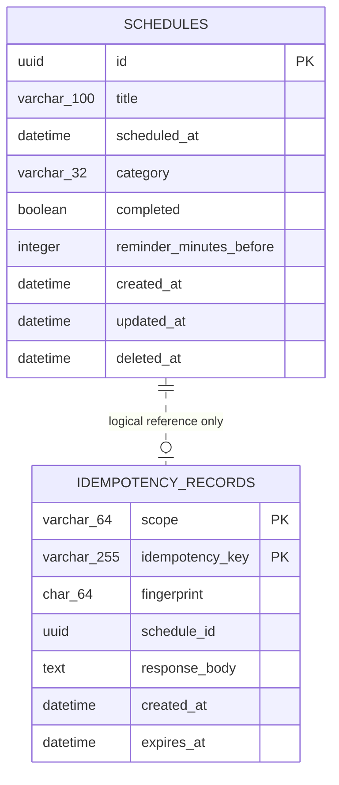

# Schedule 데이터베이스 ERD

> 상태: `BE-CONFIRMED`  
> 범위: MVP Schedule 데이터베이스

## 1. 개요

MVP 데이터베이스는 다음 두 테이블로 구성한다.

- `schedules`: 일정의 현재 상태와 soft delete 상태 저장
- `idempotency_records`: 일정 생성 성공 응답을 24시간 동안 재생하기 위한 멱등성 기록 저장

AI를 포함한 다른 영역에는 데이터베이스 직접 연결 권한이나 직접 접근 수단을 제공하지 않는다. Schedule 데이터 연동은 상태가 확인된 API 계약을 사용한다.

## 2. ERD

`idempotency_records.schedule_id`는 생성된 일정의 위치를 재구성하기 위한 논리 참조이며 외래 키가 아니다. 멱등성 재생은 현재 Schedule 행이 아니라 저장된 성공 응답 snapshot을 기준으로 하므로 두 테이블의 생명주기를 FK나 cascade로 묶지 않는다.

## 3. `schedules`

| 컬럼 | 논리 타입 | NULL | 기본값·생성 주체 | 설명 |
|---|---|---:|---|---|
| `id` | UUID | 불가 | 애플리케이션 UUID v4 | 기본키 |
| `title` | VARCHAR(100) | 불가 | 없음 | trim 후 1~100자, 제어문자 제외 |
| `scheduled_at` | DATETIME | 불가 | 없음 | UTC로 정규화한 일정 시각 |
| `category` | VARCHAR(32) | 불가 | 없음 | 5개 카테고리 중 하나 |
| `completed` | BOOLEAN | 불가 | `false` | 생성 시 미완료 |
| `reminder_minutes_before` | INTEGER | 가능 | 없음 | MVP 입력은 `10` 또는 `null` |
| `created_at` | DATETIME | 불가 | 애플리케이션 Clock | 생성 시각, UTC |
| `updated_at` | DATETIME | 불가 | 애플리케이션 Clock | 마지막 실제 변경 시각, UTC |
| `deleted_at` | DATETIME | 가능 | 없음 | 최초 soft delete 시각, UTC |

### 제약

- 기본키 `pk_schedules`: `id`
- CHECK `ck_schedules_category`: `INVENTORY`, `RETURN`, `MEETING`, `PERSONAL`, `OTHER`
- `deleted_at`, `reminder_minutes_before`만 nullable
- 동일한 제목과 일정 시각을 가진 일정의 중복 저장 허용
- 과거 일정 판단, 제목 검증과 reminder 값 검증은 API Schema·Service가 담당
- Pi 시각이 뒤로 이동할 수 있으므로 `updated_at >= created_at` 같은 시각 순서 CHECK는 두지 않음

### Soft delete

- 최초 삭제 시 행을 제거하지 않고 `deleted_at`과 `updated_at`을 설정
- 목록·단건 조회·수정 대상은 `deleted_at IS NULL`인 일정으로 제한
- MVP에는 복원과 물리 삭제 기능을 포함하지 않음

## 4. `idempotency_records`

| 컬럼 | 논리 타입 | NULL | 기본값·생성 주체 | 설명 |
|---|---|---:|---|---|
| `scope` | VARCHAR(64) | 불가 | 애플리케이션 `default` | 현재 호출 범위와 향후 확장 지점 |
| `idempotency_key` | VARCHAR(255) | 불가 | `Idempotency-Key` 헤더 | 클라이언트 멱등성 키 |
| `fingerprint` | CHAR(64) | 불가 | SHA-256 hex | 정규화된 생성 요청 식별값 |
| `schedule_id` | UUID | 불가 | 생성할 Schedule ID | 최초 응답의 `Location` 재구성, FK 없음 |
| `response_body` | TEXT | 불가 | 애플리케이션 | 최초 전송한 201 JSON 문자열 |
| `created_at` | DATETIME | 불가 | 애플리케이션 Clock | 기록 생성 시각, UTC |
| `expires_at` | DATETIME | 불가 | `created_at + 24시간` | 멱등성 유효기간 경계 |

### 제약과 생명주기

- 복합 기본키 `pk_idempotency_records`: `(scope, idempotency_key)`
- 같은 컬럼의 중복 UNIQUE와 별도 surrogate ID를 만들지 않음
- `schedule_id`에 FK와 cascade를 두지 않음
- 성공한 일정 생성의 최종 응답만 저장하고 실패·rollback 응답은 저장하지 않음
- 활성 조건은 `expires_at > now`, 만료 조건은 `expires_at <= now`
- 만료 기록은 다음 일정 생성 요청에서 정리하며 별도 주기적 cleanup job은 두지 않음

## 5. 인덱스

| 이름 | 테이블 | 컬럼 순서 | 목적 |
|---|---|---|---|
| `pk_schedules` | `schedules` | `id` | 단건 조회·수정·삭제 |
| `ix_schedules_active_time` | `schedules` | `deleted_at, scheduled_at, created_at, id` | 활성 일정 기간 조회와 고정 정렬 |
| `pk_idempotency_records` | `idempotency_records` | `scope, idempotency_key` | 멱등성 조회와 동시 생성 충돌 방지 |
| `ix_idempotency_records_expires_at` | `idempotency_records` | `expires_at` | 만료 기록 삭제 |

MVP 예상 데이터량과 최대 92일의 조회 범위를 기준으로 `category`, `completed` 단독 인덱스는 두지 않는다. 추가 인덱스는 실제 query와 측정 결과를 확인한 뒤 migration으로 추가한다.

## 6. 저장하지 않는 값

- `reminderAt`: `scheduled_at - reminder_minutes_before`로 응답 생성 시 계산
- 모바일 로컬 알림의 `notificationIdentifier`
- Assistant 대화와 conversation context
- STT 음성, LLM prompt·응답, TTS binary
- 사용자와 소유권 정보: MVP는 단일 사용자이며 다중 사용자·인증은 `POST-MVP`

## 7. 확장 원칙

- 반복 일정, 종료 시각, 종일 일정과 복수 알림은 현재 테이블에 미리 nullable 컬럼으로 넣지 않는다.
- 새 기능이 확정되면 Alembic migration과 호환 가능한 API 추가로 확장한다.
- 다중 사용자 도입 시 소유권 컬럼의 nullable 추가, backfill, NOT NULL·인덱스 적용 순서로 확장한다.
- 재고·폐기·작업 기록은 Schedule과 다른 도메인이므로 기능이 채택되면 별도 테이블·Service·API로 추가한다.
